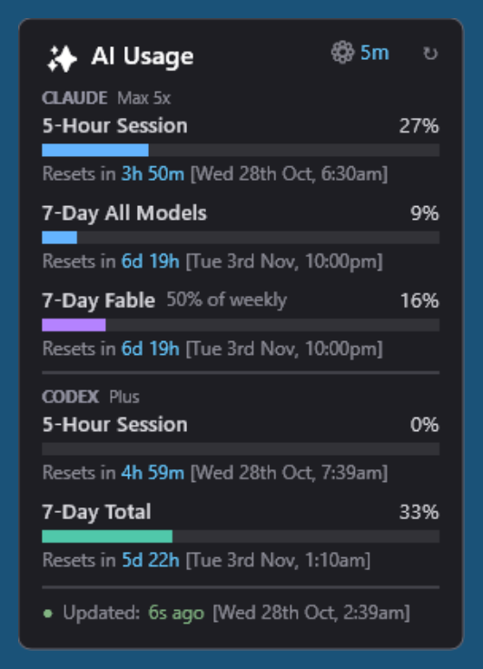

# AI Usage Monitor — Rainmeter Widget

A Rainmeter widget showing **Claude** and **Codex / ChatGPT** usage limits side by side on your desktop.



---

## What it shows

**Claude** (tier badge read from your local Claude Code credentials)

| Row | Source |
| --- | --- |
| 5-Hour Session | `limits[]` where `kind = session` |
| 7-Day All Models | `limits[]` where `kind = weekly_all` |
| 7-Day *&lt;model&gt;* | `limits[]` where `kind = weekly_scoped` — the model name and its share of the weekly allowance both come from the API, so the row follows whatever model your plan currently meters |
| Week: … | `seven_day_breakdown` — where the weekly allowance actually went (Claude Code / Chats / Cowork / Other) |

**Codex / ChatGPT** (plan type from the API)

| Row | Source |
| --- | --- |
| 5-Hour Session | `rate_limit.primary_window` |
| 7-Day Total | `rate_limit.secondary_window` |

Bars turn amber past 75% and red past 90%.

---

## Requirements

- Windows 10 or later
- [Rainmeter](https://www.rainmeter.net/) 4.5+
- Windows PowerShell 5.1 (ships with Windows) **or** PowerShell 7 — the script runs on both
- At least one of:
  - **Claude Code**, logged in — provides `~/.claude/.credentials.json`
  - **Codex**, logged in with a ChatGPT account — provides `~/.codex/auth.json`

If only one is present, that provider's rows populate and the other shows why it is unavailable. Neither is required for the other to work.

---

## Installation

### From the packaged skin

1. Download the `.rmskin` from [Releases](../../releases).
2. Double-click it. Rainmeter installs and loads the skin.

### Manual

1. Copy `Skins/ClaudeUsage` into your Rainmeter skins folder. The exact path is whatever `SkinPath` says in `%APPDATA%\Rainmeter\Rainmeter.ini` — commonly `%USERPROFILE%\Documents\Rainmeter\Skins\`, but it follows a redirected Documents folder (OneDrive, for instance).
2. Right-click the Rainmeter tray icon → **Refresh all**.
3. Right-click the tray icon → **Skins → ClaudeUsage → ClaudeUsage.ini**.

### Building the `.rmskin` yourself

```powershell
.\build.ps1
```

A `.rmskin` is a ZIP with a 16-byte trailer: an int64 of the ZIP length, a flags byte, then `RMSKIN\0`. Zipping the folder by hand produces a package Rainmeter rejects with *"Invalid package … The Skin Packager tool must be used"*. `build.ps1` writes that trailer, so the output installs normally.

---

## Configuration

Right-click the widget for refresh interval (1–30 min) and size (100–250%) presets.

Everything else lives in `Skins/ClaudeUsage/@Resources/Variables.inc`:

| Variable | Purpose |
| --- | --- |
| `Scale` | Master zoom. `1` is the original size, `2` is double. Decimals work. Every dimension and font size derives from it. |
| `RefreshInterval` | Seconds between API calls. Default 300. |
| `WarningThreshold` / `CriticalThreshold` | Percentages at which bars turn amber / red. |
| `WidgetHeight` | Raise this if you change fonts and the footer runs past the background. |
| Colour variables | Background, text, bars, per-provider accents. |

After editing, right-click the skin → **Refresh**.

---

## When something breaks

The widget tells you rather than silently showing zeroes:

- The **status dot** in the footer is green when both providers answered, amber when one is down, red when neither is.
- A **red line under the footer** names what failed, e.g. `Claude: Rate limited. Please wait before retrying.` Long messages are clipped — hover the line for the full text.
- The **Codex plan badge** is replaced by the failure reason: `expired`, `auth failed`, `forbidden`, `unreachable`, `no auth`.

Common cases:

| Shown | Meaning |
| --- | --- |
| `Codex: expired` | The ChatGPT token in `auth.json` has lapsed. Run Codex once; it refreshes the token itself. |
| `Codex: forbidden` | The usage endpoint refused the request. It is undocumented — it may have moved. |
| `Claude: Rate limited` | Too many calls to the usage API. It clears on its own; raise `RefreshInterval` if it recurs. |
| `Claude: Token refresh throttled` | The token endpoint turned the renewal away. The next cycle retries; nothing to do. |
| `Claude: Token refresh failed` | The refresh token itself is dead (28 days unused, or spent elsewhere). Sign in again: `claude auth login` - `claude.cmd auth login` on a PowerShell that blocks the `.ps1` shim. |
| Everything blank, no error | Rainmeter could not run the script. Check Rainmeter's log: tray icon → **About → Log**. |

---

## How it works

```
Claude Code OAuth token ─┐
                         ├─→ Get-ClaudeUsage.ps1 ─→ %APPDATA%\ClaudeUsage\usage.json ─→ Rainmeter
Codex OAuth token ───────┘
```

A single PowerShell script reads both local token files, calls each provider's usage endpoint, and writes one small JSON file. Rainmeter parses that file — it never talks to either API directly.

Each provider is fetched inside its own `try`/`catch` and parsed by its own regex, so a failure on one side cannot blank the other.

### Endpoints

| Provider | Endpoint | Status |
| --- | --- | --- |
| Claude | `https://api.anthropic.com/api/oauth/usage` | Used by Claude Code itself |
| Codex | `https://chatgpt.com/backend-api/wham/usage` | **Undocumented.** May change without notice; the widget degrades to an error badge if it does. |

### A note on the Claude tier badge

The Anthropic usage response carries no plan name. The badge is read from `rateLimitTier` in your local credentials file (`default_claude_max_5x` → `Max 5x`), falling back to `subscriptionType` if that field is ever absent.

---

## Why no Gemini?

Asked often enough to be worth writing down. As of October 2026 there is no supported
way to read Gemini usage for a personal account:

- **Gemini CLI OAuth** is refused outright. Signing in returns *"This client is no longer
  supported for Gemini Code Assist for individuals. To continue using Gemini, please
  migrate to the Antigravity suite of products."* This covers individual, AI Pro and Ultra
  accounts — **Google AI Pro is a consumer plan and is included in the cutoff**. Gemini Code
  Assist Standard/Enterprise, a separate Google Cloud product, is reportedly still served.
- **A Gemini API key** authenticates against `generativelanguage.googleapis.com`, which has
  no quota endpoint. API-key usage is tracked through Cloud billing/monitoring, needing a
  GCP project and service account.
- **Antigravity** holds the only readable numbers, via an undocumented local RPC —
  `POST /exa.language_server_pb.LanguageServerService/GetUserStatus` on its language
  server's loopback port, authenticated with a CSRF token from the process command line.
  Even if wired up, it works only while the IDE is running, exposes only the 5-hour window
  (not the weekly limit), and regenerates its port and token every launch.

That last option was deliberately not implemented: it is strictly worse than the other two
providers, which read persistent token files and work whether or not any app is open. If
you want Gemini numbers today, an IDE extension such as
[Henrik-3/AntigravityQuota](https://github.com/Henrik-3/AntigravityQuota) is the better
tool for the job.

The provider structure here is per-section, so adding Gemini later is a fetch function, a
regex and a third section — whenever Google ships something supported.

## Privacy

- Tokens are read from your own local files and sent only to the provider they belong to — Anthropic's token to Anthropic, the ChatGPT token to OpenAI. Nowhere else.
- `usage.json` holds only percentages, reset timestamps, plan tier and status text. No tokens, account IDs or email addresses are written to it.
- Nothing is sent anywhere else, and the widget only reads usage data — it cannot change either account.
- The Codex token file is only ever read. The Claude one is rewritten, but only to renew it: see below.
- Renewing the Claude token is the one write this widget makes, and it exists because not writing it was worse. The access token lasts 8 hours and only the standalone CLI rewrites the file - the desktop app renews inside its own session - so the file goes stale while the account is perfectly logged in, and the widget used to answer that with "sign in again". Worse, the server **rotates** the refresh token on every renewal: anything that renews without saving the result leaves a dead grant on disk and forces a real login. So the widget renews and saves, 30 minutes before expiry: `File.Replace` swaps the file in whole, so a concurrent reader never sees half a file, and the previous copy stays as `.credentials.json.bak`. Only `accessToken`, `refreshToken` and `expiresAt` change; MCP server entries are written back untouched.

---

## Credits

Original **Claude Usage Monitor** by **JayDeeAU** (Joe Demian @ Codemian) — [DeviantArt](https://www.deviantart.com/jaydeeau/art/Claude-Usage-Monitor-Rainmeter-Widget-1290968321).

This fork adds Codex/ChatGPT support, replaces the retired per-model Sonnet bucket with the API-driven scoped-model row, adds plan tier badges, on-skin error reporting and a `Scale` variable, and fixes the packaging so the `.rmskin` installs.

**This is not open source.** The original grants no licence — its page ends
"© 2026 JayDeeAU" and names no terms of use — so it is all rights reserved, and
a fork cannot license it on the author's behalf. This repository claimed "MIT
licensed" until 2026-10-26; that claim was wrong and has been withdrawn. Only
this fork's own changes are offered under MIT. See [LICENSE](LICENSE) for what
that does and does not cover.
